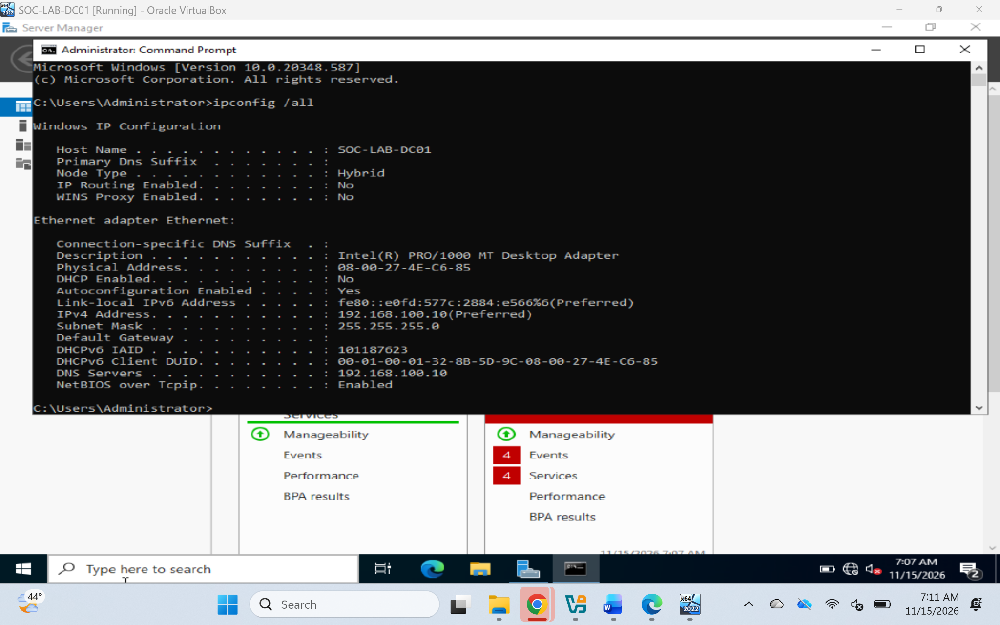
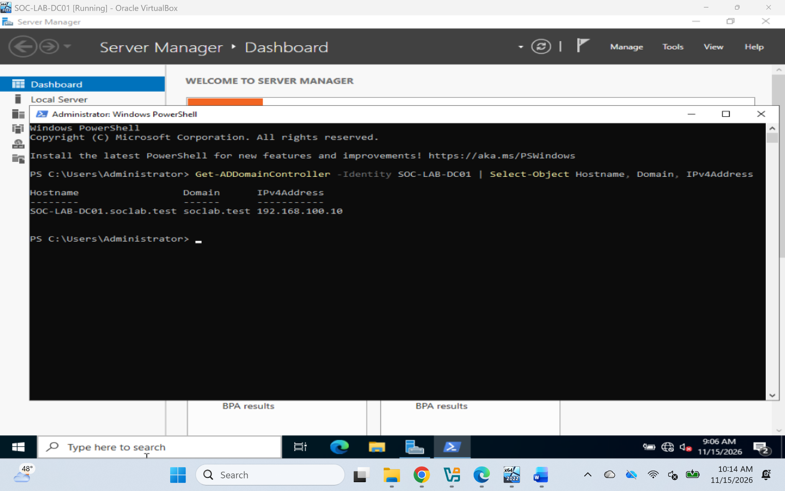
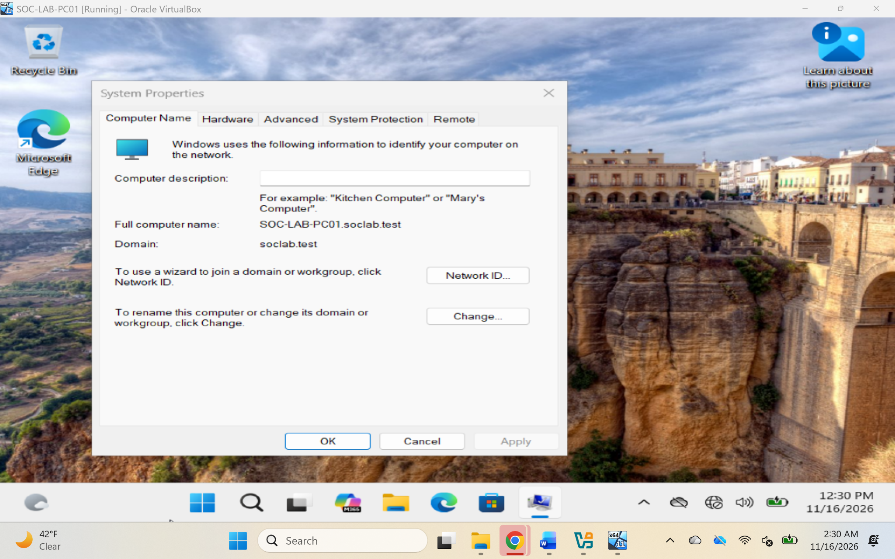
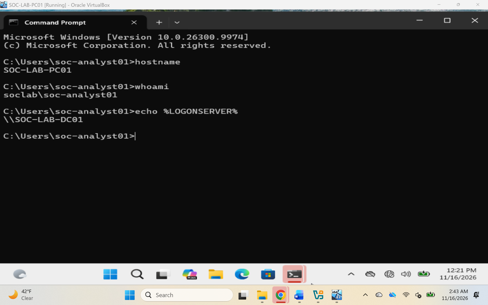
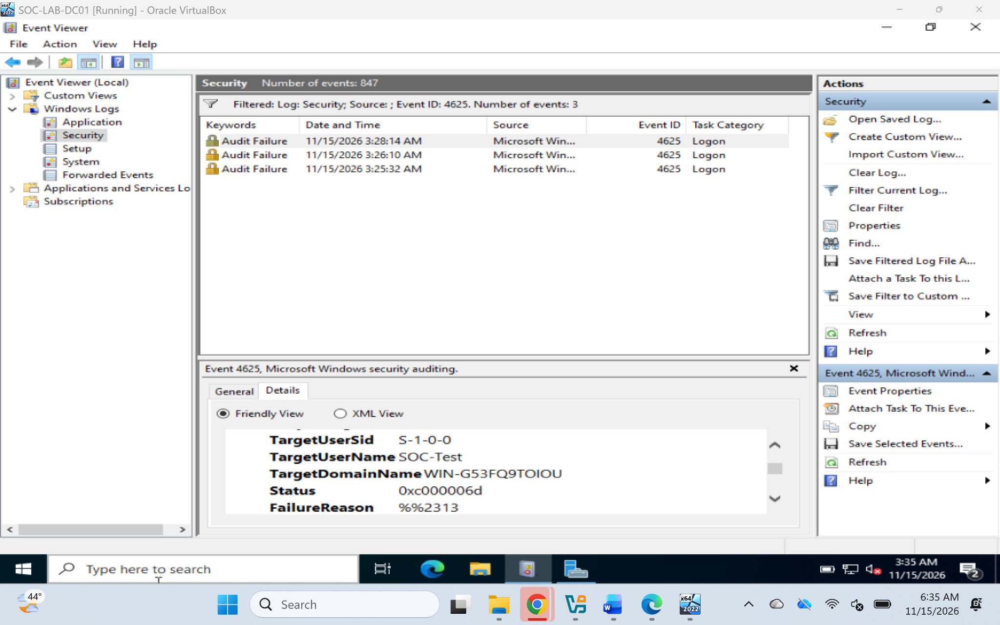
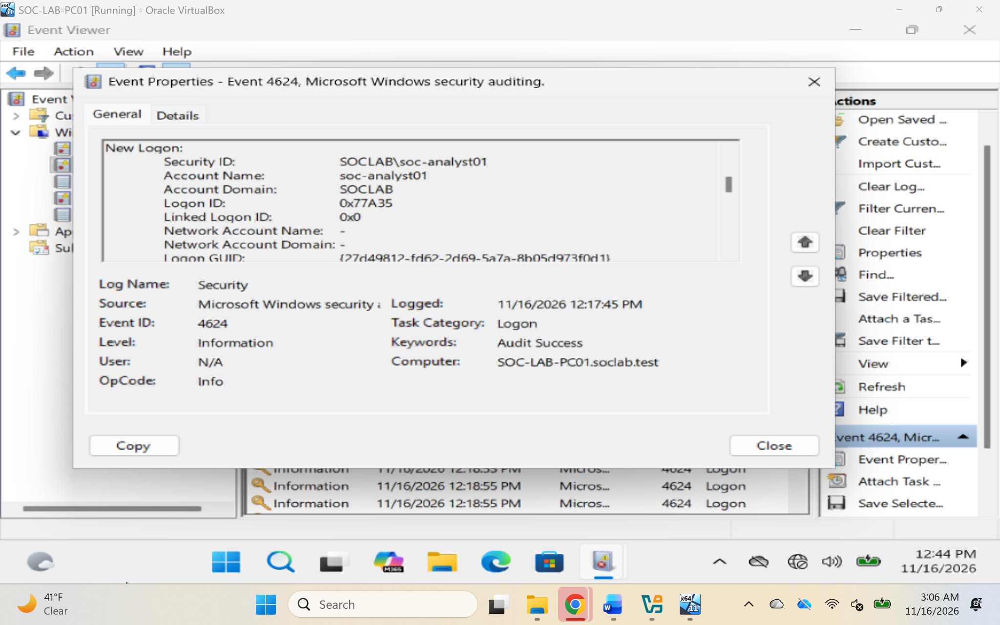
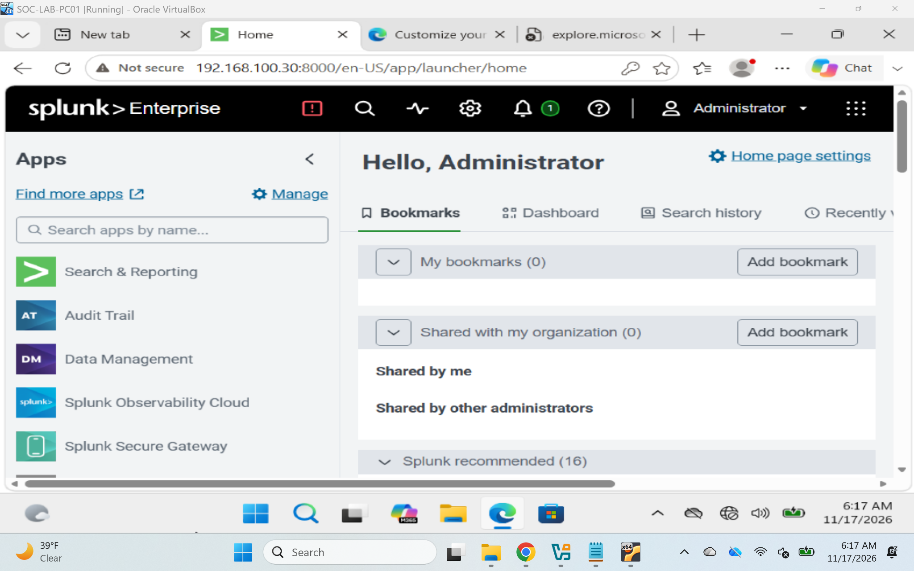
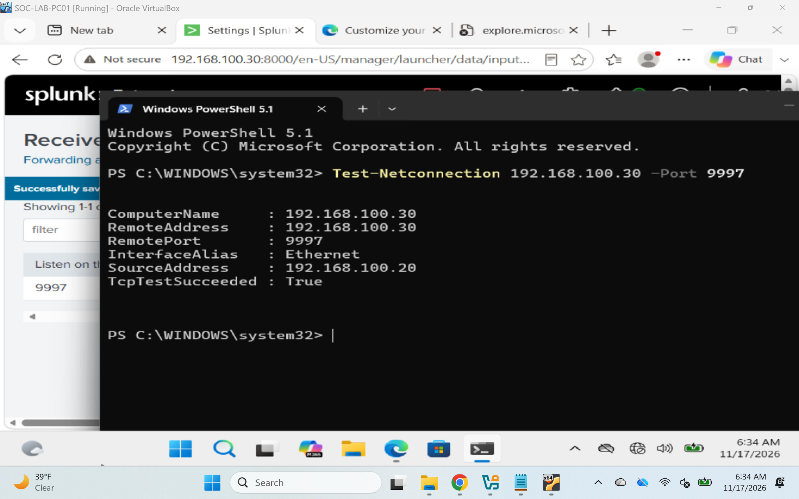
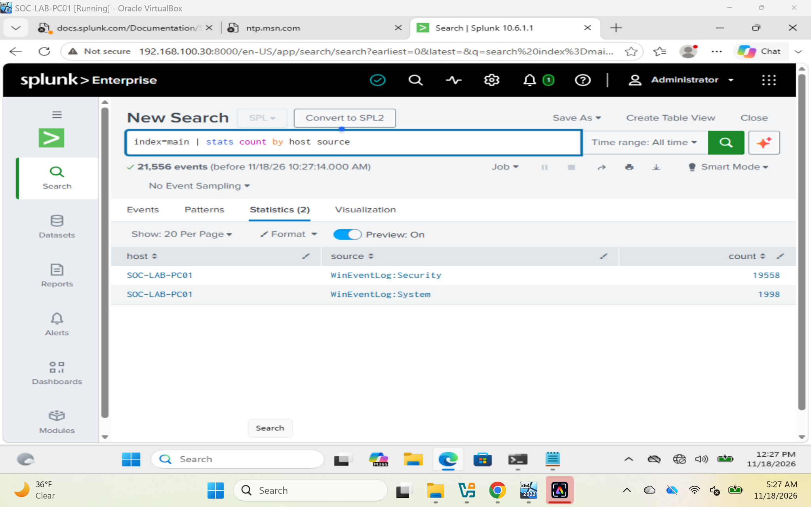
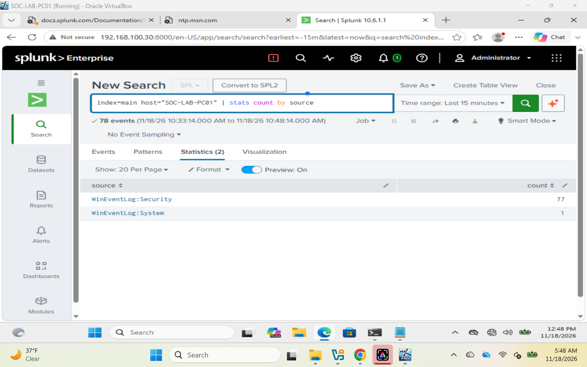

# SOC Lab — Centralized Windows Log Collection with Splunk

## What did I build?

I built a virtual SOC environment that centralizes Windows Security and System logs in Splunk Enterprise.

A Windows workstation sends events through the Splunk Universal Forwarder to an Ubuntu SIEM server. The workstation belongs to an Active Directory domain.

| System | Role | IP address |
|---|---|---|
| SOC-LAB-DC01 | Active Directory domain controller and DNS for soclab.test | 192.168.100.10 |
| SOC-LAB-PC01 | Windows workstation with Universal Forwarder | 192.168.100.20 |
| SOC-LAB-SIEM02 | Ubuntu server with Splunk Enterprise | 192.168.100.30 |

The Windows workstation forwards logs over TCP port 9997. Analysts access Splunk Web through port 8000.

## Why did I build it?

Businesses need searchable records of endpoint activity to investigate suspicious behavior and diagnose operational problems.

I built this lab to practice collecting that evidence centrally and verifying its availability. It establishes the foundation for future detection and SOC triage exercises.

## What business problem does this address?

When logs remain on individual workstations, investigators must access each affected computer and collect evidence manually. This can delay investigations, especially when several systems are involved.

Centralized collection gives analysts one location to search authentication activity and system events. It also supports collaboration by allowing investigators to work from the same collected evidence.

This project demonstrates that collection workflow for one Windows endpoint.

## How did I build it?

1. Used a domain-joined Windows workstation in an Active Directory environment.
2. Installed Splunk Enterprise on Ubuntu.
3. Configured the SIEM server with the IP address 192.168.100.30.
4. Enabled the Splunk receiver on TCP port 9997.
5. Installed the Splunk Universal Forwarder on SOC-LAB-PC01.
6. Configured its receiving destination as 192.168.100.30:9997.
7. Enabled Windows Security and System event collection.
8. Configured Splunk to run under its dedicated Linux account.
9. Enabled automatic Splunk startup through systemd.
10. Verified ingestion and tested SIEM access after an Ubuntu reboot.

**Data flow**

Windows event logs → Universal Forwarder → Splunk receiver → searchable events

## What data did I collect?

| Source | Business use |
|---|---|
| Windows Security | Provides evidence for investigating authentication, account use, and other audited security activity |
| Windows System | Helps investigate operating-system problems, service failures, and endpoint availability |

Collecting both sources helps an analyst examine security activity alongside the system conditions surrounding it.

## What broke?

### Splunk Web became unavailable

PC01 could no longer open Splunk Web. Troubleshooting showed that Ubuntu retained its configured IP address, while the Splunk process was stopped.

**Business impact**

An unavailable SIEM can delay investigations and interrupt access to monitoring data.

### The forwarder was running, but Windows events were missing

The Universal Forwarder service was running, its destination was correct, and TCP port 9997 was reachable. Searches still returned no Windows events.

Configuration checks showed that Security and System event-log inputs were missing.

**Business impact**

Service availability alone does not establish monitoring coverage. A business could believe an endpoint is monitored while the required evidence is absent.

### The isolated workstation could not download its installer

PC01 lacked internet access. I needed to transfer the installer from the physical host.

**Business impact**

Restricted environments need a workable method of delivering approved software to endpoints.

## How did I fix the issues?

I investigated the collection path in stages.

For Splunk Enterprise, I checked the Ubuntu IP address, listening port, process status, and installation ownership. I started Splunk using the dedicated splunk account and configured automatic startup.

For the Windows forwarder, I checked its service, network connectivity, and effective output configuration. I then added the missing inputs to:

`C:\Program Files\SplunkUniversalForwarder\etc\system\local\inputs.conf`

```ini
[WinEventLog://Security]
disabled = 0
index = main

[WinEventLog://System]
disabled = 0
index = main
```

After restarting the forwarder through its CLI, the events appeared in Splunk.

For installer delivery, I installed VirtualBox Guest Additions and used a shared folder to transfer the MSI into PC01.

## How did I recover?

I restored the stopped Splunk service using its dedicated account:

```bash
sudo -u splunk /opt/splunk/bin/splunk start
```

After stopping Splunk, I configured systemd to start it automatically:

```bash
sudo -u splunk /opt/splunk/bin/splunk stop
sudo /opt/splunk/bin/splunk enable boot-start -systemd-managed 1 -user splunk -group splunk
sudo systemctl start Splunkd
systemctl is-enabled Splunkd
systemctl is-active Splunkd
```

The service checks returned enabled and active. After rebooting Ubuntu, I confirmed that PC01 could access Splunk Web and searched recent endpoint events.

**Business relevance**

Testing recovery helps establish whether monitoring remains available after routine maintenance or a server restart.

## How did I verify the solution?

| Test | Observed result |
|---|---|
| PC01 connection to the receiver | TcpTestSucceeded returned True for port 9997 |
| Universal Forwarder service | Running |
| Forwarding destination | 192.168.100.30:9997 |
| Initial ingestion check | 19,558 Security events and 1,998 System events |
| Automatic startup configuration | Enabled and active |
| Splunk Web after Ubuntu reboot | Accessible from PC01 |
| Recent-event check after reboot | 77 Security events and 1 System event in a 15-minute window |

I used the following search to verify endpoint log sources:

```spl
index=main host="SOC-LAB-PC01"
| stats count by source
```

The event counts are observations captured during testing. The 15-minute search was run after the reboot; that search window alone does not establish that every returned event was generated after the reboot.

## What business value did I demonstrate?

- **Investigation readiness** — Endpoint evidence is searchable from a central location.
- **Operational visibility** — Security and System events are available together.
- **Monitoring verification** — Actual event delivery was checked alongside service and network status.
- **Recovery capability** — SIEM access and recent-event availability were checked after a reboot.
- **Repeatability** — Configuration and troubleshooting steps are documented for reuse.

These outcomes were demonstrated in a lab. Investigation time savings and production-scale performance were not measured.

## What did I learn?

I learned to verify monitoring across the complete collection path.

A running forwarder, a reachable port, configured inputs, and searchable events each establish a different part of the workflow. Checking them together helped me identify the missing event-log inputs.

I also practiced service recovery, Linux account permissions, software transfer into an isolated VM, and automatic startup configuration.

## What skills does this demonstrate?

- Splunk Enterprise administration.
- Windows Universal Forwarder configuration.
- Windows Security and System log collection.
- Active Directory lab integration.
- PowerShell and Linux troubleshooting.
- TCP connectivity testing.
- Configuration inspection with btool.
- SPL searches for ingestion verification.
- Service recovery and systemd startup.
- Technical documentation and evidence collection.

## What would a business deployment require?

The lab uses one monitored Windows endpoint and HTTP access to Splunk Web. A business deployment would need additional design and testing for:

- HTTPS access and encrypted forwarding.
- Analyst roles and access controls.
- Storage capacity, retention, and licensing.
- Consistent time synchronization.
- Alerts for interrupted log collection.
- Central management of forwarder configurations.
- Backup, restoration, and availability requirements.
- Privacy controls for collected event data.

## Follow-on investigation: Lab 2

I used the collected PC01 Security logs to investigate two controlled failed logons. I confirmed EventCode 4625 in Splunk, reviewed the account context, and found zero matching successful-logon events in the searched data.

[Lab 2: investigation, searches, and screenshots](lab-02-failed-logon-triage/README.md) · [Short triage report](lab-02-failed-logon-triage/triage-report.md)

The infrastructure evidence below documents the original collection phase. Lab 2 records its own findings and limits, including clock discrepancies and VM stability concerns.

## Project evidence

### Domain and endpoint configuration

#### Server network configuration

The domain controller uses `192.168.100.10`, with DHCP disabled and DNS pointing to its own address. A consistent address helps clients locate domain services.



#### Domain controller verification

PowerShell confirms the domain controller hostname, `soclab.test` domain, and IP address. This establishes the identity infrastructure used by the lab.



#### Windows workstation domain membership

PC01 is joined to `soclab.test`, establishing the domain context for endpoint authentication.



#### Domain user sign-in verification

The hostname, signed-in user, and logon server identify the workstation, domain account, and authenticating server. These details help an investigator attribute activity to the correct system and account.



### Local authentication event validation

#### Failed-logon evidence on DC01

Event Viewer on DC01 shows three failed-logon events with Event ID `4625`. Authentication-failure records provide evidence to examine during later investigation exercises. These events alone do not establish malicious activity.



#### Successful-logon evidence on PC01

Event ID `4624` records a successful logon for the lab domain user on PC01. This provides an example of the account and computer context available in a Windows Security event.



These two screenshots document local Windows event validation. The centralized ingestion demonstrated below covers PC01's Security and System logs; DC01 log forwarding was not demonstrated in this phase.

### SIEM access and receiver connectivity

#### Splunk Web access from PC01

The workstation can access Splunk Web and sign in. This verifies the analyst's access path to the SIEM interface.



#### Receiver connectivity on TCP port 9997

`TcpTestSucceeded: True` confirms PC01 can establish a TCP connection to `192.168.100.30:9997`. This validates network reachability; indexed events provide the separate check that collection works end to end.



### Centralized collection and recovery verification

#### Windows logs indexed in Splunk

The search returns **19,558 Security events** and **1,998 System events** for PC01, totaling **21,556 events**. This confirms that endpoint evidence reached the central searchable index.



#### Recent events checked after the SIEM reboot

During the recovery check, a 15-minute search returns **77 Security events** and **1 System event**. Together with successful Web access after the reboot, this documents the availability checks performed following the SIEM restart.



This phase establishes log collection and recovery verification. The linked Lab 2 documents the subsequent controlled SOC triage exercise; automated alert development has not been demonstrated.
