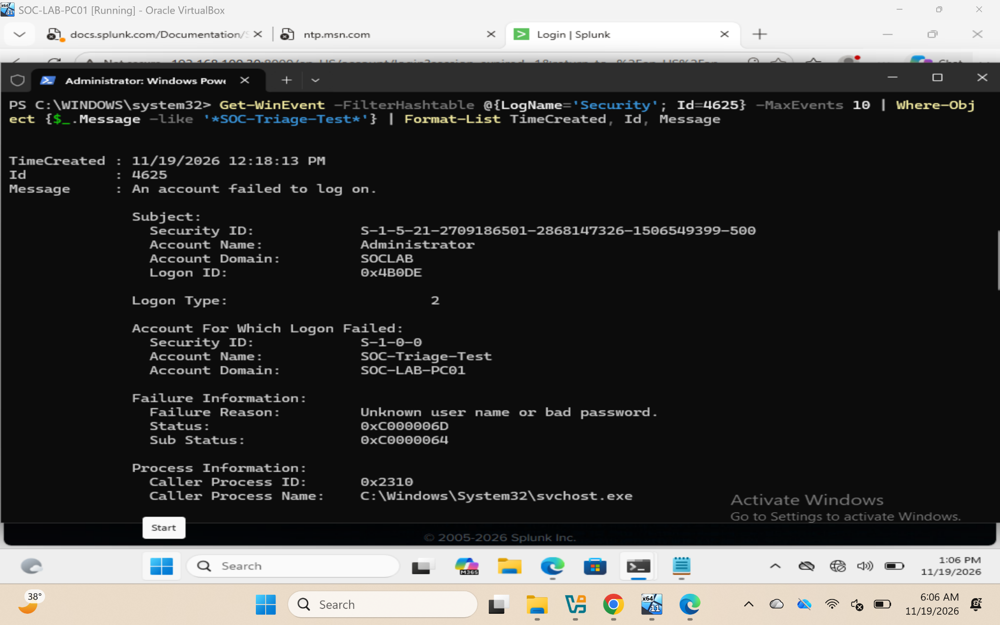
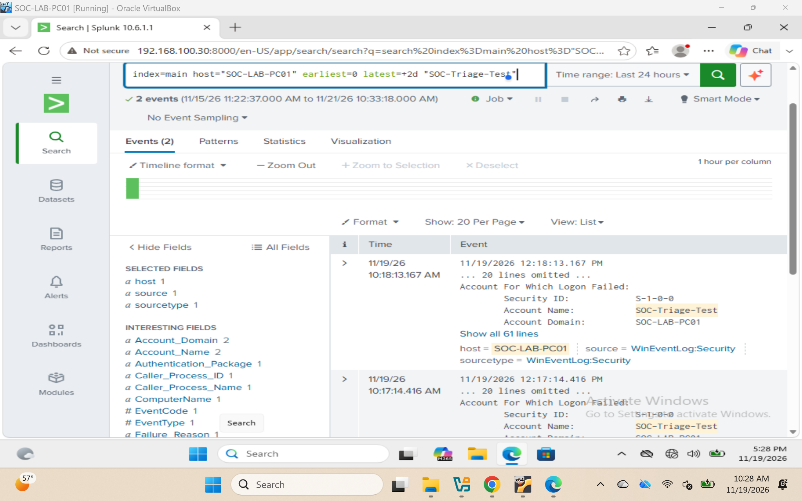
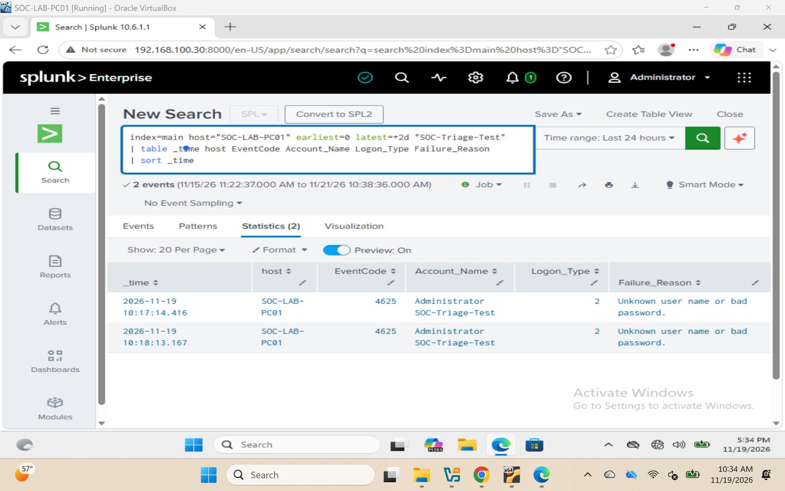
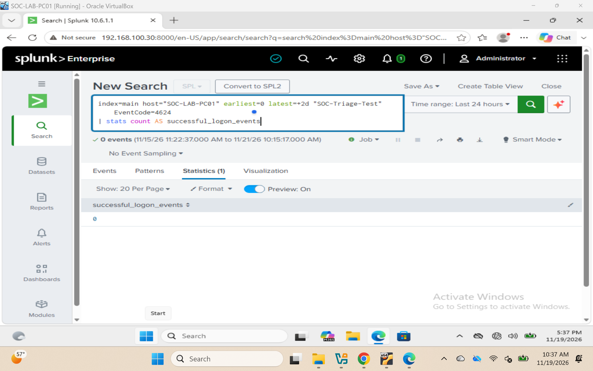
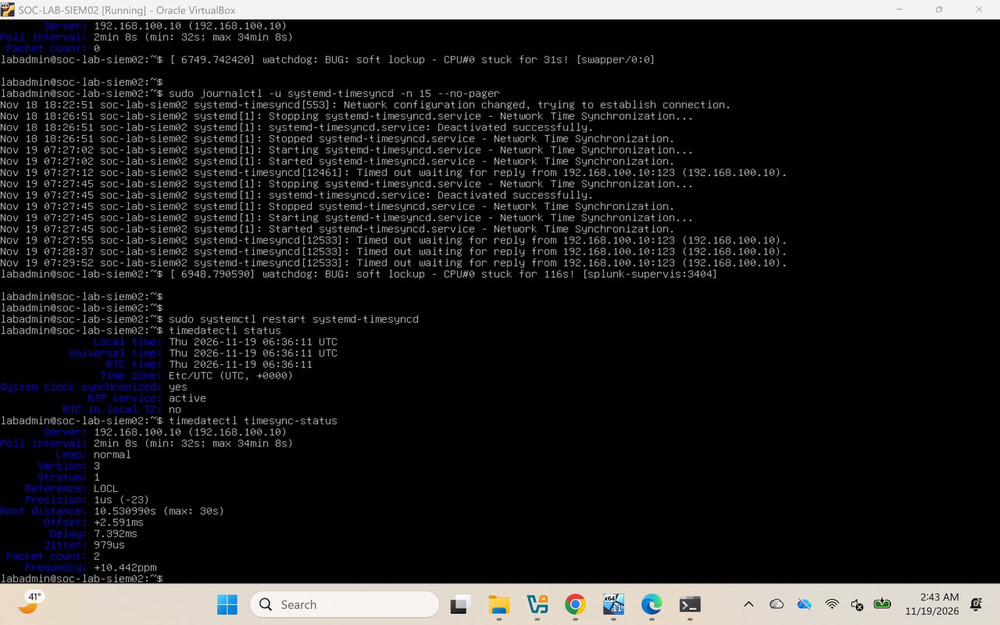
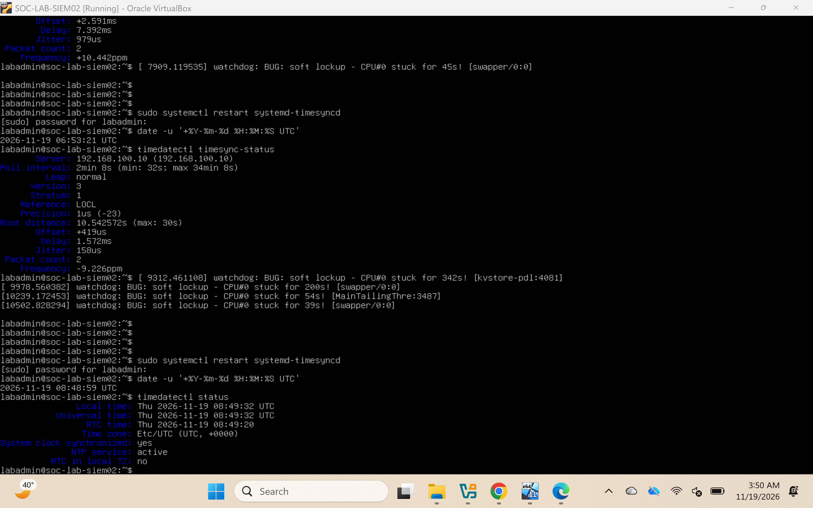
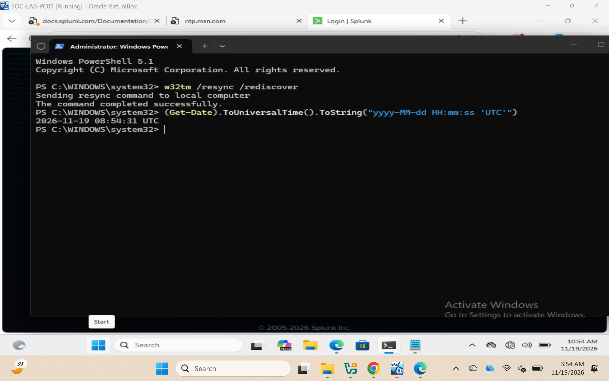
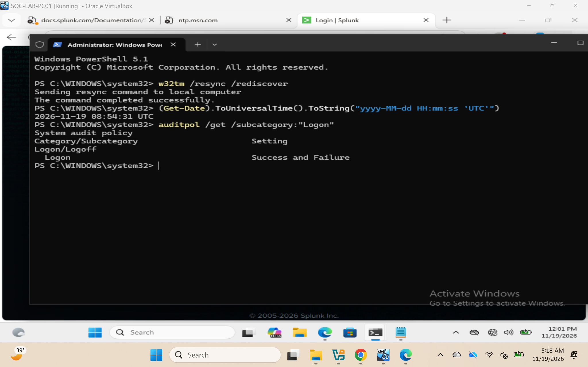
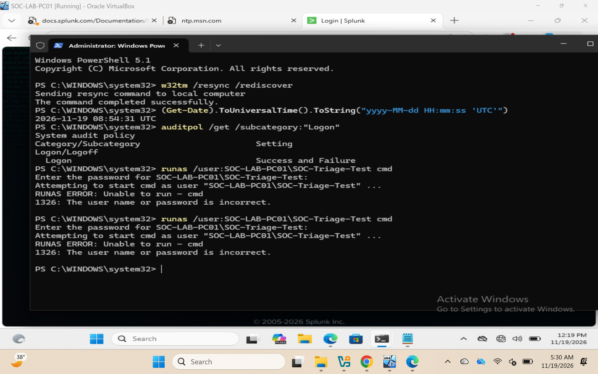

# Lab 2 — Failed-logon investigation and SOC triage

## What did I investigate?

I investigated two controlled failed logon attempts for a nonexistent local test account on a Windows workstation. I followed the evidence from Windows Security logs to Splunk and checked for matching successful logons.

## Why did I do it?

A failed login needs context. An analyst must identify the affected computer and attempted account, understand the failure, and decide whether the activity needs escalation. This exercise let me practice that process and write a concise case record.

## How did I investigate?

1. Verified that Logon auditing included success and failure.
2. Used `runas` twice with `SOC-LAB-PC01\SOC-Triage-Test` to generate deliberate authentication failures.
3. Confirmed Event ID 4625 locally with PowerShell.
4. Located the two test-account events in Splunk.
5. Reviewed event codes, account context, logon type, and failure reason.
6. Searched for EventCode 4624 mentioning the test account and recorded zero matches.
7. Classified the activity and wrote the [triage report](triage-report.md).

## What did I find?

| Check | Result |
|---|---|
| Endpoint | SOC-LAB-PC01 |
| Failed logons | 2, EventCode 4625 |
| Attempted account | SOC-Triage-Test |
| Logon type | 2, interactive |
| Matching successful logons | 0 found in the searched indexed data |
| Classification | Expected authorized test activity |
| Priority and disposition | Low; closed as a lab test |

## What broke, and how did I work through it?

Initial searches returned no results despite local Windows evidence. Clock discrepancies complicated the search window. I checked ingestion separately and widened the event-time range to include two days beyond the SIEM's current time. Both test events then appeared. This demonstrates visibility in the widened window; it does not prove that timekeeping is permanently fixed or that every missing-result issue had the same cause.

I also corrected command-entry mistakes and enabled VirtualBox's shared clipboard so I could paste searches accurately. The `Account_Name` field contained both the initiating and attempted accounts, so I checked the raw event before attributing the failure.

## What did I learn?

I learned to separate a failed authentication from a successful compromise, verify local evidence against indexed data, and document what a search actually supports. I also learned that account-field extraction and inconsistent clocks can mislead an investigation if I do not check the underlying records.

## What is the business value?

This exercise demonstrates evidence-based triage: identify the activity, check its context and outcome, assign a priority, and leave a clear record for another analyst. It provides a repeatable example of handling an authorized test without unnecessary escalation. Investigation speed and production effectiveness were not measured.

## Searches used

Paste each complete block into Splunk's search box.

### Find the test-account events

```spl
index=main host="SOC-LAB-PC01" earliest=0 latest=+2d "SOC-Triage-Test"
```

### Review the failed-logon evidence

```spl
index=main host="SOC-LAB-PC01" earliest=0 latest=+2d "SOC-Triage-Test"
| table _time host EventCode Account_Name Logon_Type Failure_Reason
| sort _time
```

### Check for successful logons mentioning the account

```spl
index=main host="SOC-LAB-PC01" earliest=0 latest=+2d "SOC-Triage-Test" EventCode=4624
| stats count AS successful_logon_events
```

The broad time window was a troubleshooting measure for this lab. The report records timezone uncertainty, ingestion limits, and unresolved VM stability concerns. The successful-logon query searches for the name anywhere in the event; it is not a dedicated target-account field filter.

## Evidence

### Local Windows validation



### Events located centrally



### Failed-logon findings



### Outcome check



[Read the short triage report](triage-report.md) · [Return to the infrastructure lab](../README.md)

## Supporting setup and troubleshooting evidence

The first NTP capture shows synchronization to DC01 before its clock was corrected. Synchronization alone does not establish accurate time. The second capture records the later correction check; neither proves long-term clock stability.











