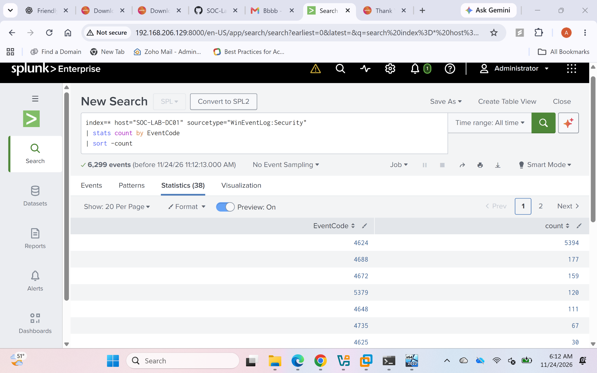
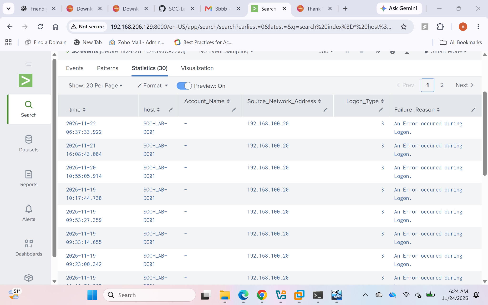
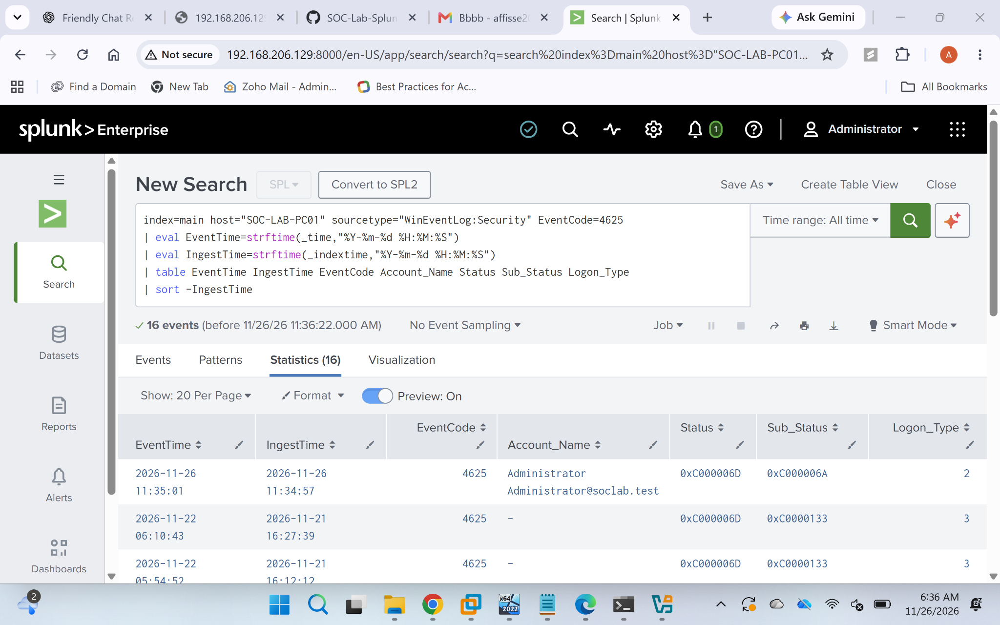
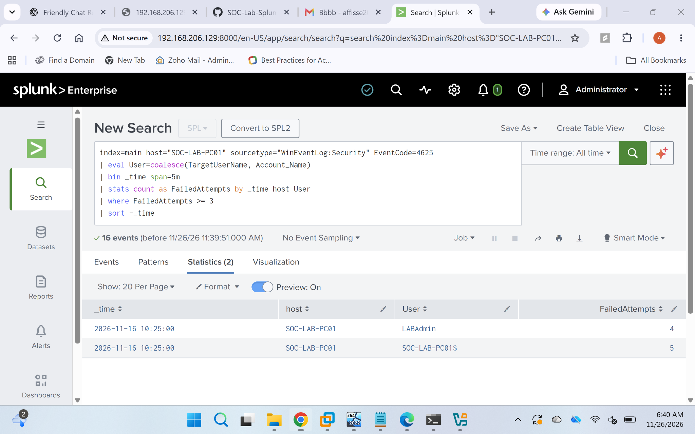
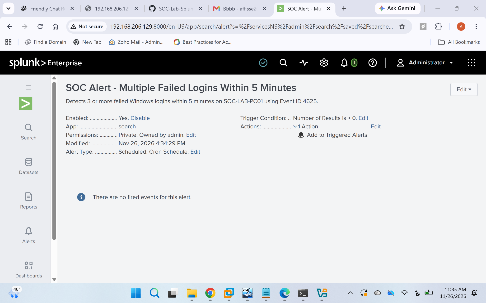
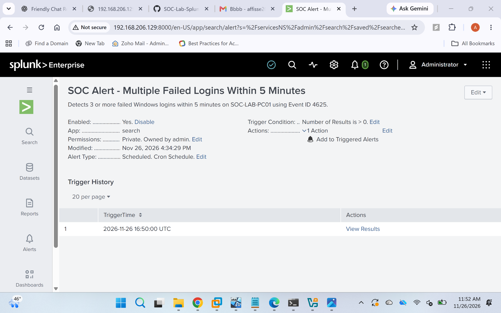
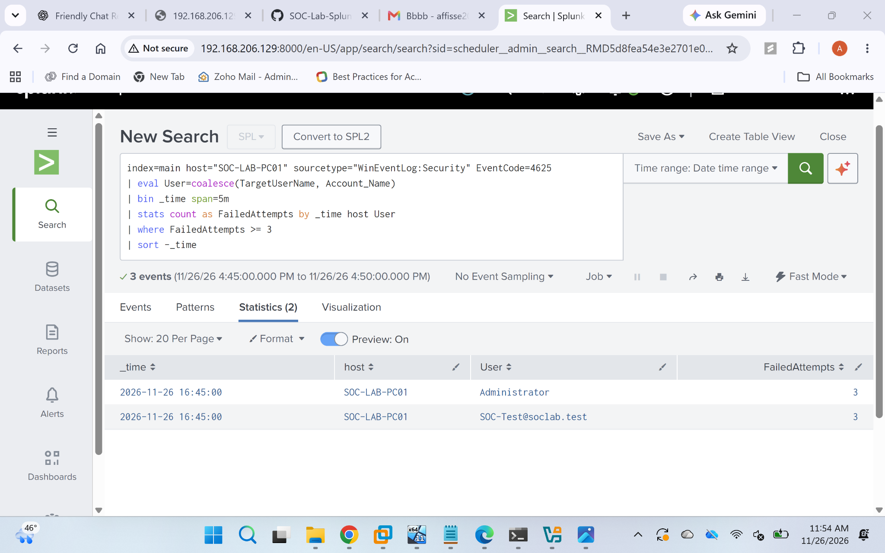

# Lab 3 — Splunk Failed-Login Detection, Scheduled Alert, and Validation

## What did I build?

I extended my existing Windows/Active Directory SOC lab with a Splunk Enterprise detection for repeated failed logins on `SOC-LAB-PC01`. The detection uses Windows Security **Event ID 4625**, identifies accounts with **three or more failures in a five-minute window**, and runs automatically as a **scheduled alert every five minutes**.

I validated it with an authorized three-attempt incorrect-password test against the non-administrator domain account `SOC-Test@soclab.test`. Splunk received the events, the alert fired, and its trigger-history results showed the test account.

**Scope:** One monitored Windows endpoint; results are from a controlled home lab, not production security monitoring.

## Why did I build it?

Centralized log collection is only the first step in a SOC workflow. Analysts also need repeatable searches, detection thresholds, scheduled evaluations, and triage evidence. This lab demonstrates the progression from **collection → detection → alert → investigation**.

## Environment and data flow

| Component | Role |
|---|---|
| `SOC-LAB-DC01` | Active Directory domain controller for `soclab.test` |
| `SOC-LAB-PC01` | Domain-joined Windows 11 endpoint; Splunk Universal Forwarder; security-event source |
| `SOC-LAB-SIEM02-VMware` | Ubuntu 24.04 VM running Splunk Enterprise |
| `192.168.206.129:8000` | Splunk Web on VMware NAT network |
| `192.168.56.1:9997` | Windows-host forwarding relay used by PC01 |
| `192.168.206.129:9997` | Active Splunk receiver behind the relay |

**Data flow:** Windows Security log → Splunk Universal Forwarder on PC01 → Windows host TCP port forwarding → Splunk receiver on Ubuntu → `index=main` → SPL detection → scheduled alert.

This VMware/VirtualBox connectivity path supersedes the original lab's `192.168.100.30` SIEM address; that historical address appears in the earlier infrastructure documentation.

## What did I do?

1. Restored access to `SOC-LAB-PC01` after a VirtualBox display issue.
2. Confirmed that Splunk Enterprise on the Ubuntu VM was running and available via Splunk Web.
3. Checked the Universal Forwarder's active destination, `192.168.56.1:9997`.
4. Identified and disabled an obsolete deployment-client configuration pointing at `192.168.100.30:9997`, while preserving event forwarding.
5. Verified fresh `WinEventLog:Security` ingestion from PC01 in Splunk.
6. Generated and detected a single authorized incorrect-password attempt (`EventCode=4625`, `0xC000006D` / `0xC000006A`, Logon Type 2).
7. Created and saved a repeated-failure detection report using historical records.
8. Created an enabled scheduled alert with a five-minute lookback and cron expression `*/5 * * * *`.
9. Generated three controlled incorrect-password attempts for `SOC-Test@soclab.test`; all returned Windows `runas` error 1326.
10. Verified the three events in Splunk and checked the alert's trigger history and saved results.

## SPL searches

### Verify recent Security log ingestion

```spl
index=main host="SOC-LAB-PC01" sourcetype="WinEventLog:Security"
| eval EventTime=strftime(_time,"%Y-%m-%d %H:%M:%S")
| eval IngestTime=strftime(_indextime,"%Y-%m-%d %H:%M:%S")
| sort -_indextime
| table EventTime IngestTime EventCode host
| head 10
```

### Investigate failed logins

```spl
index=main host="SOC-LAB-PC01" sourcetype="WinEventLog:Security" EventCode=4625
| eval EventTime=strftime(_time,"%Y-%m-%d %H:%M:%S")
| table EventTime EventCode Account_Name Status Sub_Status Logon_Type
| sort -EventTime
```

### Saved historical detection report

```spl
index=main host="SOC-LAB-PC01" sourcetype="WinEventLog:Security" EventCode=4625
| eval User=coalesce(TargetUserName, Account_Name)
| bin _time span=5m
| stats count as FailedAttempts by _time host User
| where FailedAttempts >= 3
| sort -_time
```

**Interpretation:** `bin span=5m` creates fixed, non-overlapping five-minute buckets. This is not a sliding window. `coalesce` chooses an extracted account field; review `_raw` to differentiate the initiating account from the attempted account when necessary.

### Scheduled alert search (concept)

```spl
index=main host="SOC-LAB-PC01" sourcetype="WinEventLog:Security" EventCode=4625
| eval User=coalesce(TargetUserName, Account_Name)
| bin _time span=5m
| stats count as FailedAttempts by _time host User
| where FailedAttempts >= 3
| sort -_time
```

Configured in the Splunk UI with **Time Range: Last 5 minutes**, **Scheduled**, cron `*/5 * * * *`, trigger **Number of Results > 0**, **Trigger Once**, **Add to Triggered Alerts**, and **Medium** severity. The actual saved search is scoped by Splunk's time-range setting.

## What did I find?

| Evidence | Observation |
|---|---|
| Fresh PC01 security-log ingestion | Indexed on November 26, 2026; recent examples included Event IDs 4624 and 4672 |
| Single authorized incorrect-password test | Event ID 4625; `Administrator@soclab.test`; substatus `0xC000006A`; Logon Type 2 |
| Historical repeated-failure report | Four `LABAdmin` and five `SOC-LAB-PC01$` failures in one five-minute bucket on Nov 16 |
| Controlled alert test | Three incorrect-password attempts using `SOC-Test@soclab.test` on Nov 26 |
| Resulting search | Three failures for `SOC-Test@soclab.test` and three for `Administrator` in the inspected 15-minute data |
| Alert configuration | Enabled; scheduled; Add to Triggered Alerts action |
| Trigger history | Triggered November 26, 2026, **16:50 UTC** |
| Triggered search results | `SOC-Test@soclab.test`: 3; `Administrator`: 3; host `SOC-LAB-PC01`; bucket displayed as 16:45 UTC |

The test-account activity was authorized and intentional. The Administrator failures also appeared in the alert results; their cause was not independently established by the displayed summary, so this lab does **not** label those events an intrusion.

## What broke? How did I recover?

- **VirtualBox black/white display for PC01:** I restored usable access to the guest before continuing the security workflow. The lab also confirmed the VM was running when its display was unavailable.
- **Old SIEM address still configured as deployment server:** The Universal Forwarder logged repeated HTTP 502/time-out warnings for `192.168.100.30:9997`. Inspection of `deploymentclient.conf` identified the obsolete target. I backed up and disabled that optional deployment-client file and restored the service.
- **Restart-Service did not complete initially:** I inspected service state, verified elevated PowerShell, started `SplunkForwarder`, and confirmed **Running** and **Active forwards: 192.168.56.1:9997**.
- **Older historical failure not found in Splunk:** The local PC01 Security log contained a Nov 25 Event 4625 with Record ID `32053`, but searches could not locate it in the indexed data. I did not erase checkpoints or claim its absence was resolved; instead, I validated the working live pipeline using a new controlled event.
- **Splunk trial-license warning:** The UI confirmed that scheduled searches will stop running after the Splunk Enterprise Trial license expires. Monitoring continuity therefore depends on an appropriate license.

## SOC triage result

**Case:** LAB-003  
**Date:** November 26, 2026  
**Detection:** Multiple failed Windows interactive logons (Event ID 4625)  
**Source:** SOC-LAB-PC01  
**Priority:** Low for the known authorized test; alert configured at Medium severity  
**Disposition:** Closed for the SOC-Test simulation, with separate review warranted for unrelated Administrator failures.

See the [incident triage report](triage-report.md) for the evidence, assessment, and limitations.

## Evidence screenshots

The seven screenshots document the workflow from Windows Security log collection through the triggered Splunk alert.

### 01 — Security logs collected from the domain controller



### 02 — Historical Windows Event ID 4625 analysis



### 03 — Individual PC01 failed-login event detected



### 04 — Multiple failed-logon detection search



### 05 — Scheduled SOC alert enabled



### 06 — Trigger history confirms the alert fired



### 07 — Triggered alert investigation results



## What did I learn?

I practiced writing SPL detections, handling Windows authentication fields, distinguishing a saved report from a scheduled alert, verifying a successful alert trigger, and producing an evidence-based triage record. I also learned that validating the live ingestion path does not prove complete historical-event coverage.

## Business relevance and limits

This is a reproducible proof of concept, not a production-hardened SIEM. A production deployment would need robust time synchronization; authenticated/encrypted forwarding; tested account-field normalization; noise reduction for computer accounts; an appropriate Splunk license; tuned thresholds and overlapping windows if required; alert ownership, escalation and response runbooks; and monitoring for missing data.

[Return to the main SOC lab](../README.md) · [Lab 2: initial triage investigation](../lab-02-failed-logon-triage/README.md)
